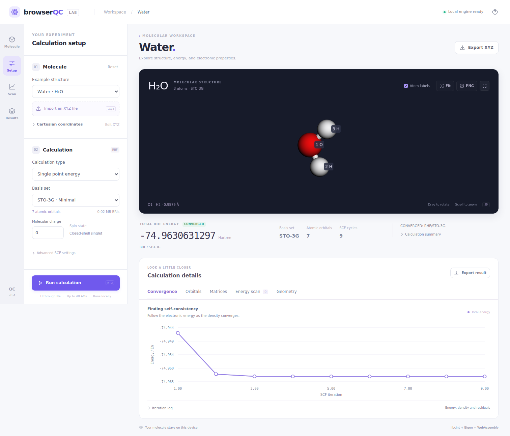

# browser-qchem

Electronic structure calculations inside a web browser, using compiled
scientific libraries and no remote calculation API.

## Molecular workspace

Run closed-shell restricted Hartree-Fock (RHF) directly in the browser. Enter a
geometry and molecular charge, follow live SCF iterations, inspect orbital
energies, density and Fock matrices, and export numerical results as JSON.
Choose STO-3G, 6-31G, or cc-pVDZ for H through Ne. The workspace includes a
rotatable 3D molecule, XYZ upload, atom picking, live SCF and PES plots, matrix
inspection, and numerical exports. The default water/STO-3G calculation converges
in 9 iterations to
**-74.963063129729 Eh** with DIIS enabled.

The solver uses libcint integrals and Eigen diagonalization and linear solves.
The default convergence criteria are energy change < 1e-10 Eh, AO density RMS
change < 1e-8, and orthonormal-basis commutator RMS < 1e-8. Results that reach
the iteration limit are labeled **NOT CONVERGED**, including in JSON metadata.

## Molecular integral foundation

Compute the complete overlap S, kinetic T, nuclear attraction V, and electron
repulsion tensor for editable molecular geometries. The default example is
water/STO-3G. Inspect S, T, V, T+V, individual ERIs, and download all numerical
results as JSON. Select **Integrals only** to use the earlier integral calculator.

The browser bundles all three basis catalogs locally, including general
contractions and spherical d functions in cc-pVDZ. Input may be a
standard XYZ file's contents (atom count, comment line, then coordinates) or
plain `Element x y z` lines. Select angstrom or bohr explicitly. The backend
uses bohr. RHF requires a positive even electron count and assumes spin 0;
electron count and spin are not required for integrals-only calculations.

libcint is pinned to commit `8d13863ff481cea27efea5e56c9e4d352cdb8f80` (v6.1.2).
Eigen is pinned to `3147391d946bb4b6c68edd901f2add6ac1f31f8c` (3.4.0).
Both are unmodified git submodules. Updating from the integral milestone requires
`git submodule update --init --recursive` to download Eigen's headers.
The build uses C/C++ and one computation thread inside a browser worker.
There is no Python runtime or remote calculation API in the browser. No special
cross-origin isolation headers are needed for this single-worker implementation.

## Set up on macOS

Git, Python 3, CMake >= 3.20, a Make-compatible build tool, and Emscripten
are needed to build. Git already works on your machine. If needed, install
Apple's command-line tools with `xcode-select --install`.

With conda, create a dedicated build environment:

```bash
conda create -n browser-qchem -c conda-forge python=3.12 cmake -y
conda activate browser-qchem
```

From the repository root, install Emscripten **4.0.10** into an ignored tools
directory. No administrator access or Homebrew is required:

```bash
mkdir -p .tools
git clone https://github.com/emscripten-core/emsdk.git .tools/emsdk
./.tools/emsdk/emsdk install 4.0.10
./.tools/emsdk/emsdk activate 4.0.10
source .tools/emsdk/emsdk_env.sh
emcc --version
```

Downloads are substantial on the first install. If an SDK is already installed,
activate it and source its `emsdk_env.sh` instead. Version 4.0.10 is the initial
tested toolchain rather than a requirement to track the latest SDK.

## Build and open the page

From the repository root:

```bash
git submodule update --init --recursive
bash scripts/build_wasm.sh
node tests/check_wasm.mjs
node tests/check_molecular.mjs
node tests/check_rhf.mjs
node tests/check_workspace.mjs
python3 -m http.server 8000 --bind 127.0.0.1 --directory build/wasm/dist
```

Open **http://localhost:8000**. The default water calculation should show:

- 5 shells and 7 AOs.
- Three 7 x 7 one-electron matrices and 2401 electron repulsion integrals.
- Nuclear repulsion energy **9.188258417746 Eh**.
- Total RHF energy **-74.963063129729 Eh**.
- **CONVERGED: RHF/STO-3G.**

In integrals-only mode, the live PASS message checks normalization and integral symmetries. It is not
a runtime PySCF comparison for arbitrary entered geometries. The included
numerical tests compare full arrays against PySCF. On updating from the first
demo, rebuild and reload the browser with Cmd+Shift+R to refresh the JS and WASM.

The local Python server only serves static files; all integral evaluation
happens in the browser. No external assets or calculation services are used.
Stop the server with Ctrl+C. Use HTTP rather than opening the HTML as a file.

For a new terminal session, reactivate the tools before rebuilding:

```bash
conda activate browser-qchem
source .tools/emsdk/emsdk_env.sh
```

Re-run the build after changing the C code or webpage. CMake copies the webpage
into `build/wasm/dist`; do not edit the generated copies there.

## Interface and navigation

The workspace puts the molecule on a dark 3D canvas, with calculation controls
in a fixed setup panel and a compact energy summary above the result tabs.
The Run/Stop control stays visible while the setup panel scrolls. Coordinate
editing, advanced SCF options, detailed summaries and iteration logs expand when
needed. Invalid geometry opens the coordinate editor, and calculation errors
open their summary.

- **Molecule** opens coordinate editing; **Setup** focuses the basis selector.
- **Scan** selects the bond scan and brings its controls into view.
- **Results** jumps to the analysis panels. Result tabs support arrow keys,
  Home and End. Selecting an SCF chart point opens and highlights its log row.
- The expand icon gives the molecule a larger canvas; **Esc** restores the
  workspace. Molecular framing adapts to the canvas dimensions.
- **Cmd+Enter** or **Ctrl+Enter** runs the calculation. The **?** button opens a
  short workspace guide.
- On phones and tablets, **Setup** opens the configuration drawer. The bottom
  action bar keeps setup and Run/Stop available while viewing results. Running
  closes the drawer, and **Esc** closes it without starting a calculation.



## Explore a molecule and scan a bond

1. Select an example or upload an XYZ file. Choose the coordinate unit and basis.
   The viewer and AO count update before you calculate. Water uses 7 AOs in
   STO-3G, 13 in 6-31G, and 24 in cc-pVDZ. Calculations above 40 AOs are disabled.
2. Drag to rotate, scroll to zoom, and use **Fit** to frame the structure.
   Atom labels match the one-based indices in the geometry input. **PNG** exports
   the current view; **Export geometry** writes an XYZ file in angstrom.
3. Select **Bond scan · RHF**. Click atom A and then atom B, or type their indices.
   A stays fixed. B and every listed moving atom translate along the original AB
   direction. **Use connected fragment** proposes the fragment on B's side after
   removing AB from an inferred bond graph. Check the highlighted selection;
   cyclic structures require an explicit moving group. Inferred bonds affect
   display/selection only and do not enter the electronic structure calculation.
4. Set the start/end distance, angstrom or bohr, and 2 to 101 points. Descending
   ranges are supported. Run to calculate points sequentially in the worker.
   Every geometry is generated from the original input, avoiding accumulated drift.
5. Select a curve point or table row to inspect its geometry and SCF details.
   The viewer, editor, energy and matrices follow that point. Relative energies
   use the lowest converged point in the current scan. Unconverged points are
   marked and are not connected by the curve; errors retain an explanatory row.
6. **Stop calculation** cancels between integral/SCF steps. A synchronous WASM
   integral call finishes before cancellation can be handled. Completed points
   remain available. Export energies as CSV, all completed geometries as a
   multi-frame XYZ, or compact results and metadata as JSON. Failed geometries
   remain in XYZ/JSON with their status; CSV leaves unavailable energies blank.

These are **unrelaxed bond scans**: the other coordinates are not optimized.
Each point uses an independent core-Hamiltonian guess. There is no state
following, orbital stability test, or guarantee of the lowest RHF solution.
Core guesses can converge to excited SCF roots, including for N2. Inspect the
curve for discontinuities and verify the electronic state before interpreting a
PES. Restricted HF also cannot describe general bond dissociation correctly.

Single-point JSON contains all integrals. Scan JSON omits the large ERI tensor at
each point, retaining one-electron matrices and RHF results. To inspect a scan
geometry's ERIs, select the point and run **Single point · RHF**. Exported JSON
molecular coordinates are in bohr; XYZ coordinates are in angstrom. Units and
status accompany all scan energies. Selecting an older completed point during a
scan keeps that point selected while later points continue to calculate.

The viewer uses the bundled 3Dmol.js 2.5.5 build. Without WebGL, calculations and
atom-index scan controls still work. No external asset is required at runtime.

## Numerical checks

`node tests/check_wasm.mjs` runs the actual compiled WebAssembly module at
eight separations, including zero separation as a normalization check, and
checks invalid inputs. Its reference is the closed-form contracted s-Gaussian
overlap with the same basis coefficients, normalized as a contraction.
The absolute comparison tolerance is `1e-12`.

`node tests/check_molecular.mjs` checks every entry of the water integral arrays
against the committed PySCF 2.14.0 reference in `tests/fixtures/water-sto3g.json`.
It also checks unit conversion, H2 regression, rejected inputs, recovery, and
correct heap access after WebAssembly memory growth. No PySCF installation is
needed to run the Node checks.

`node tests/check_rhf.mjs` compares the computed water energy, density, Fock, and
orbital energies with a committed PySCF reference, then checks convergence
thresholds, DIIS off, a forced iteration limit, molecular charge, invalid input,
near-linear-dependence rejection, and recovery. All four Node checks run the
actual compiled WASM engine, not a JavaScript numerical substitute.

`node tests/check_workspace.mjs` compares water and five-point H2 scans in each
basis against committed PySCF references. It checks rigid fragment geometry,
reverse ranges, bohr units, ring selection, AO limits, cancellation during SCF,
partial exports, unconverged/failed points, and recovery. Regenerate the small
reference with `python3 tests/generate_workspace_reference.py`. Regenerate the
basis catalog with `python3 scripts/generate_basis.py` using PySCF 2.14.0.

To compare all integrals directly with an installed PySCF, including H through Ne
atoms, H2, water, skew water, methane, ammonia, HF, LiH, and BeH2:

```bash
python3 -m pip install pyscf
cmake -S . -B build/native -DCMAKE_BUILD_TYPE=Release -DCMAKE_POLICY_VERSION_MINIMUM=3.5
cmake --build build/native --parallel 4
python3 tests/check_molecular.py --native build/native/libqc_core.dylib
python3 tests/check_molecular.py --wasm
python3 tests/check_rhf.py --native build/native/libqc_core.dylib
python3 tests/check_rhf.py --wasm
python3 tests/check_basis.py
```

The basis check compares every S, T, V and ERI entry plus RHF energies and
densities for water, skew water, ammonia and methane in all three bases. In 12
cases, maximum differences were 3.56e-14 for integrals, 3.63e-13 Eh for energies,
and 1.12e-8 for density entries. The cc-pVDZ cases exercise general contractions
and all five spherical d functions. All integral entries for the 30 H-Ne
atom/basis combinations also pass, with maximum difference 4.27e-14.

On Linux the native library is `build/native/libqc_core.so`. The native test
also exercises custom s/p/d shells. PySCF is a development reference only.
Agreement checks basis normalization, shell ordering, units, signs, array layout,
and integration through our wrapper. PySCF also uses libcint, so this is not an
independent validation of libcint's integral algorithm. The original H2
analytical formula remains an independent check of that overlap case.

`python3 tests/generate_water_reference.py` regenerates the committed water
reference using PySCF directly. It never calls our wrapper.
`python3 tests/generate_rhf_reference.py` similarly regenerates the water RHF
reference using PySCF's RHF solver.

For the optional end-to-end browser check:

```bash
python3 -m pip install playwright numpy pillow
python3 -m playwright install chromium
python3 tests/check_browser.py
python3 tests/check_browser_rhf.py
python3 tests/check_browser_workspace.py
python3 tests/check_browser_interface.py
```

This starts a temporary localhost server, loads the real WASM module in a worker,
compares every downloaded water integral against the reference, and checks matrix
and ERI inspection, bohr input, invalid geometry, recovery, and narrow layout.
The RHF browser test additionally checks energy and density in downloaded JSON,
orbital energies, density/Fock matrix inspection, live iteration messages, a
forced nonconverged calculation, odd-electron rejection, and recovery.

The workspace browser check covers actual WebGL rendering, rotation, atom
picking, connected-fragment selection, PNG export, cc-pVDZ worker results,
AO preflight, XYZ upload, PES point inspection, CSV/XYZ/JSON downloads, stopping
a scan, failed-point cleanup, nonconvergence, recovery and mobile layout.

The interface browser check additionally verifies persistent actions,
progressive disclosure, navigation and keyboard controls, help, viewer focus,
mobile single-point and scan workflows, and layouts from 360 to 1440 pixels.

Initial native and WASM validation passed on Linux x86_64 with Emscripten 4.0.10,
Node 24, PySCF 2.14.0, and headless Chromium 134. Across the 18 atom/molecule cases,
the maximum absolute integral difference was **2.85e-14**. The integral and RHF
baselines were also confirmed on the user's Mac. The new basis/viewer/scan
workspace is validated on Linux and awaits its first Mac run.

The native and WASM RHF checks compare 13 cases against PySCF RHF with a
core-Hamiltonian guess: H2, stretched H2, water, skew water, methane, ammonia,
HF, LiH, BeH2, He, Ne, HeH+, and H3+. Maximum energy difference was **2.0e-13 Eh**,
maximum density-entry difference **6.7e-9**, and orbital-energy differences were
below **1.4e-9 Eh**. Tests also verify MO orthonormality, electron count,
spin-summed density idempotency, the physical Fock matrix, the generalized
eigenvalue equation, and independent recomputation of the total energy.

## RHF algorithm and conventions

The C++ core uses a symmetric S^(-1/2) orthogonalizer and a core-Hamiltonian guess.
Its spin-summed density has occupation 2 per occupied spatial orbital:

```text
D = 2 C_occ C_occ^T
F_ij = H_ij + sum_kl D_kl [ (ij|kl) - 0.5 (ik|jl) ]
E_total = 0.5 sum_ij D_ij (H_ij + F_ij) + E_nuc
```

DIIS stores up to 8 physical Fock matrices and their orthonormal-basis
commutators, X^T (FDS-SDF) X. A singular or ill-conditioned DIIS solve falls back
to the physical Fock matrix. Convergence requires all three criteria at once:
absolute energy change, density RMS change `||D_new-D_old||_F/N`, and residual
RMS `||X^T(FDS-SDF)X||_F/N`. A final canonicalization with the physical Fock
includes a checked pure SCF step before a calculation is labeled converged.

The smallest overlap eigenvalue must be >= 1e-8. The prototype rejects nearly
linearly dependent bases rather than silently dropping AOs. RHF pairs electrons
in spatial orbitals, so odd-electron and open-shell calculations need a later
UHF/ROHF extension. SCF convergence does not establish wavefunction stability or
that the solution is the global minimum. An iteration-limited energy is exported
as an unconverged result and is labeled that way on the page.

RHF JSON includes `rhf.energy`, `electronicEnergy`, `converged`, `status`,
`charge`, `electrons`, `spin`, `iterations`, `thresholds`, `history`, `density`,
`fock`, `coefficients`, `orbitalEnergies`, and `occupations`. All matrices use
flat row-major layout. `coefficients[i*N+p]` is MO p's coefficient on AO i.
MO energies are in Hartree; occupations are 2 or 0. The C RHF API borrows the
integral handle, so free the RHF handle before freeing its integrals.

## Conventions and limits

AO order is atom order, then the listed shells. For STO-3G it is
1s for H/He and 1s, 2s, 2px, 2py, 2pz for Li through Ne. General contractions
are split into separate shell records in PySCF AO order. Display labels s1, s2,
p1, etc. denote contraction order, not assigned atomic principal quantum numbers.
Spherical d functions follow libcint order xy, yz, z2, xz, x2-y2. Both primitives and
contractions are normalized in the C wrapper. Nuclear attraction includes its
negative sign. The angstrom-to-bohr conversion uses 0.52917721092 angstrom/bohr
to match the reference calculations.

Every exported array is flat and row-major. For N AOs:

- S, T, V each have N*N values, index `i*N+j`.
- ERI has N^4 values in chemists' notation `(ij|kl)`, index `((i*N+j)*N+k)*N+l`.
- JSON indices are zero-based; the interface's AO selectors are one-based.
- Coordinates in exported molecule data are in bohr. S is dimensionless;
  T, V, ERIs, and nuclear repulsion use atomic units.

The prototype limits input to 32 atoms and **40 AOs**, with a dense ERI tensor
of at most 20.48 MB. All shell quartets are evaluated; direct Fock construction,
screening strategies, tensor compression, and parallel integral evaluation are
later optimizations. Co-located nuclei, unsupported elements, malformed input,
and excessive sizes produce explicit errors. Editing geometry clears old results.

The generic C API in `src/integrals.h` accepts arrays of nuclear charges,
coordinates, shell records `[atom_index,l,nprim]`, exponents, and contraction
coefficients. It supports one contraction per shell with l=0..2 and positive
exponents. Split multiple contractions into separate shell records. The browser
catalog exposes STO-3G, 6-31G and cc-pVDZ through spherical d functions. `qc_compute`
returns an opaque result handle; read it with `qc_nao`, `qc_enuc`, `qc_data`,
then release it with `qc_free`. Inputs remain owned by the caller. No function
retains an input buffer. A null result is accompanied by a `qc_error` message.

## Files

| Path | Purpose |
| --- | --- |
| `vendor/libcint` | Pinned upstream integral library |
| `vendor/eigen` | Pinned header-only linear algebra library |
| `src/overlap.c` | Original H2 overlap regression path |
| `src/integrals.c`, `src/integrals.h` | General shell inputs and complete integral evaluation |
| `src/rhf.cpp`, `src/rhf.h` | RHF iteration, DIIS, diagonalization, and convergence |
| `CMakeLists.txt` | Build native or WebAssembly targets |
| `scripts/build_wasm.sh` | Configure and compile the browser module |
| `web/basis.mjs`, `web/molecule.mjs` | Three basis catalogs, input parsing, and AO labels |
| `web/engine.mjs`, `web/worker.mjs` | WASM memory interface and background computation |
| `web/rhf.mjs` | RHF memory ownership, iteration loop, and progress messages |
| `web/index.html`, `web/styles.css`, `web/app.mjs` | Workspace, results inspection and exports |
| `web/viewer.mjs`, `web/vendor/` | Local 3Dmol molecule viewer and license |
| `web/scan.mjs`, `web/plot.mjs` | Scan geometries, runner, exports and interactive SVG charts |
| `tests/` | Numerical comparisons, PySCF reference, and browser checks |

## License and references

The 3Dmol.js license and dependency notices are retained in
`web/vendor/3Dmol-LICENSE.txt`; its pinned source and checksum are recorded in
`web/vendor/README.md`.

The project license is retained in `LICENSE`. The libcint dependency retains its
own license in `vendor/libcint/LICENSE`.
Eigen retains its license files in `vendor/eigen/`; `EIGEN_MPL2_ONLY` is set
for this build.

- [libcint source and documentation](https://github.com/sunqm/libcint/tree/v6.1.2)
- [Eigen 3.4.0 source](https://gitlab.com/libeigen/eigen/-/tree/3.4.0)
- [3Dmol.js source](https://github.com/3dmol/3Dmol.js)
- [PySCF STO-3G source](https://github.com/pyscf/pyscf/blob/v2.14.0/pyscf/gto/basis/sto-3g.dat).
- [PySCF 6-31G source](https://github.com/pyscf/pyscf/blob/v2.14.0/pyscf/gto/basis/pople-basis/6-31G.dat)
- [PySCF cc-pVDZ source](https://github.com/pyscf/pyscf/blob/v2.14.0/pyscf/gto/basis/cc-pvdz.dat)
  The included numerical basis parameters are transcribed from PySCF 2.14.0;
  no Python is needed to use them in the browser.
- Q. Sun, *J. Comput. Chem.* **36**, 1664-1671 (2015),
  [doi:10.1002/jcc.23981](https://doi.org/10.1002/jcc.23981).
- W. J. Hehre, R. F. Stewart, J. A. Pople, *J. Chem. Phys.* **51**, 2657-2664
  (1969), [doi:10.1063/1.1672392](https://doi.org/10.1063/1.1672392).
- [Emscripten installation](https://emscripten.org/docs/getting_started/downloads.html)

